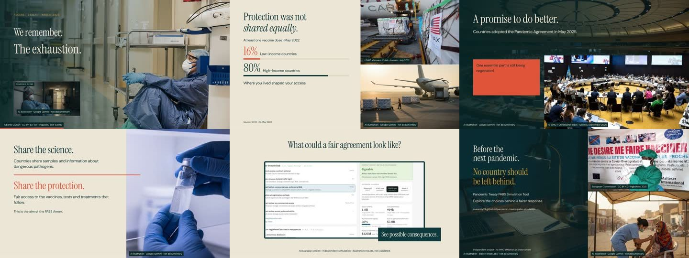
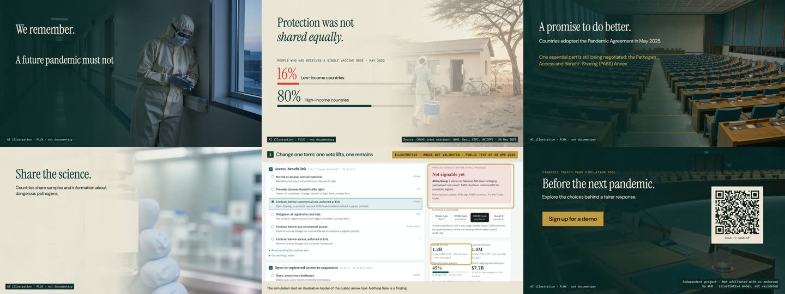
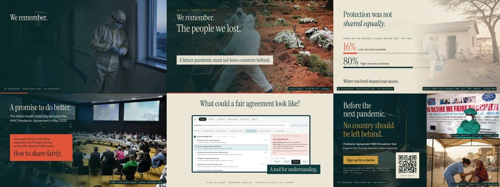

# Introduction video: three versions

The share page ([index.html](index.html)) plays Version 3. Versions 1 and 2 are kept here as reference styles.

| | Version 1 | Version 2 | Version 3 (current) |
|---|---|---|---|
| File | [pabs-pitch-v1.mp4](pabs-pitch-v1.mp4) | [pabs-pitch-v2.mp4](pabs-pitch-v2.mp4) | [pabs-pitch-v3.mp4](pabs-pitch-v3.mp4) |
| Length | 60 s | 72 s | 80.5 s |
| Made | October 2026 as an animated web page on Replit; recorded to video on 24 Oct 2026 | 21 Oct 2026 | 24 Oct 2026 |
| Imagery | Real COVID-19 photographs, with AI stills (Google Gemini, Black Forest Labs) in split-screen layouts | FLUX 3 video clips (Black Forest Labs) as full-screen backgrounds | FLUX clips and real photographs, including the WHO negotiating room |
| The tool | One app screen with captions: "Explore different choices. See possible consequences. Find common ground." | Step-by-step demo of the app, with cursor and highlights | Version 1's framing, then Version 2's demo |
| Sound | Music | Ambient sound from the clips, no music | Voiceover in a ministerial register (ElevenLabs) over Version 1's music |
| Closing | "Before the next pandemic. No country should be left behind." with photo credits and the GitHub address | "Sign up for a demo" button and QR code | Version 1's closing page with a demo button and a QR code to the request form |

## Version 1

- Kept in Version 3: the still photographs that show how serious COVID-19 was; the WHO negotiating-room photograph; "What could a fair agreement look like?" with its three captions; the closing page.
- Dropped in Version 3: the small "imagined scene" inset in the opening.
- Original page: https://pandemic-pitch-studio.replit.app/pabs-pitch/

## Version 2

- Kept in Version 3: the FLUX video clips (worker at the window, rural clinic, vaccine vial) and the app demo.
- Dropped in Version 3: the empty assembly hall and the empty desks, which did not show the room where the annex is negotiated.
- Note: this version's QR code points to an earlier demo address that no longer exists.

## Version 3

- Combines Version 1's photographs, framing and closing page with Version 2's FLUX clips and demo.
- Narration avoids "signable", "veto" and "trade"; results are described as meeting "the model's agreement criteria".
- Uses WHO terminology: "WHO Pandemic Agreement" and "PABS annex"; the tool is named "Pandemic Agreement PABS Simulation Tool", part of PABS Reset.
- QR code and button lead to the demo request form.

Image credits and AI labels appear in each video. Versions 1 and 2 are kept as they were made, including the earlier name "Pandemic Treaty". Illustrative model, not validated. Part of PABS Reset, an independent project, not affiliated with or endorsed by WHO.
